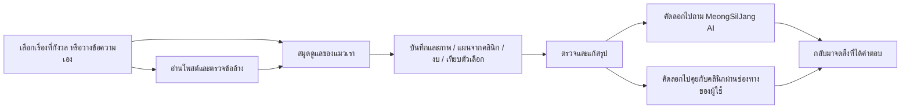

# จาก VPC สู่ UX/UI ของ Pettinee

ออกแบบและปรับต้นแบบวันที่ 19 พฤศจิกายน 2569 ใช้งานบนเครื่อง ยังไม่ deploy

## สิ่งที่พบจากสไลด์

อ้างอิง `C:/intern/pettinee/19_11_26/Pettinee_PetMommy_VPC_Final.pptx.pdf` จำนวน 8 หน้า โดยอ่านเนื้อหาและภาพสไลด์จริง หน้า 1 ระบุว่าข้อมูล 100 โพสต์ถูกคัดเลือกตามหมวด ไม่ใช่ตัวอย่างสุ่ม และ Gains/Value Map เป็นสมมติฐานที่ต้องยืนยันกับผู้ใช้

หน้า 2 แสดงปัญหาร่วมคือความกังวล ค่าใช้จ่าย ความไม่แน่ใจ และการอยากได้ประสบการณ์อื่นมายืนยันความเชื่อ UX จึงควรช่วยแยกสิ่งที่ทราบกับสิ่งที่ยังไม่ทราบ พร้อมเหตุผลและข้อมูลสำหรับถามต่อ การทำให้รู้สึกมั่นใจไม่เท่ากับพิสูจน์ว่าความเชื่อเดิมถูกต้อง

เว็บเดิมมีจุดแข็งด้านการอ่านโพสต์ แยกข้อมูลถอดความ และตรวจแต่ละข้ออ้าง แต่เริ่มจากโครงสร้างชุดข้อมูล และยังไม่มีพื้นที่เก็บบริบทของแมวตัวเอง ประวัติที่เปลี่ยนตามเวลา แผนจากคลินิก หรือข้อจำกัดงบ ผู้ใช้อ่านจบแล้วจึงยังต้องรวบรวมข้อมูลใหม่เองก่อนถามต่อ

## สิ่งที่แก้ให้ลองใช้ได้จริง

| สถานการณ์จากสไลด์ | ปัญหาที่ต้องช่วย | หน้าจอและการทำงานที่เพิ่ม | ขอบเขต |
| --- | --- | --- | --- |
| หน้า 3: การกิน อาเจียน ท้องเสีย | เล่าลำดับอาการไม่ครบ และอยากใช้คำบอกเล่าอื่นประเมินความรุนแรง | บันทึกเวลา สิ่งที่เห็น และหัวข้อที่ติดตาม รวมไปกับคำถามก่อนคัดลอก | ไม่วินิจฉัยหรือบอกระยะเวลาที่ให้รอดูอาการ |
| หน้า 4: ผิวหนัง บาดแผล ขนร่วง | จำการเปลี่ยนแปลงไม่ได้ ไม่แน่ใจวิธีที่ทำอยู่ | สมุดภาพและบันทึกตามเวลา กลับไปอ่านต้นทางและตรวจข้ออ้างได้ | ภาพเก็บในเบราว์เซอร์ ไม่วิเคราะห์ภาพ และไม่ส่งภาพอัตโนมัติ |
| หน้า 5: หลังทำหมัน หลังรักษา | หลายสิ่งต้องจำและกลัวทำตกหล่น | เพิ่มรายการจากคำแนะนำที่ได้รับ ทำเครื่องหมาย เก็บวันนัดและช่องทางคลินิก | เจ้าของเป็นผู้คัดลอกแผน เว็บไม่สร้างตารางยา/ขนาดยา และไม่มีระบบเตือนนัด |
| หน้า 6: โรคเรื้อรัง ค่ารักษา | ประวัติกระจัดกระจายและไม่รู้ว่าต้องเตรียมค่าอะไร | เก็บประวัติและรายการราคา เลือกคำถามเรื่องวัตถุประสงค์การตรวจ ค่าติดตามและช่องทางติดต่อ | รวมเฉพาะราคาที่กรอก ระบุจำนวนรายการที่ยังไม่ทราบ ไม่แต่งราคาหรือใช้ราคาเลื่อนการรักษา |
| หน้า 7: อาหาร พฤติกรรม อุปกรณ์ | รีวิวไม่ตรงกับบริบทบ้านและไม่อยากซื้อผิด | กรอกงบ/เงื่อนไข แล้วเทียบสองตัวเลือกด้านวัสดุ แหล่งไฟ การล้าง ราคา และค่าใช้ต่อเนื่อง | ไม่จัดอันดับสินค้า ไม่ใช้ความนิยมเป็นหลักฐาน อาหารเฉพาะโรคให้ทบทวนกับทีมรักษา |

หน้า 8 เป็นกรณีเจ้าของธุรกิจขายคอร์ส Business Content ซึ่งมี Customer Job ต่างจาก Pet Mommy บันทึกไว้เป็นแนวคิดอีกเส้นทาง: กรอกเป้าหมายคอนเทนต์ → ตรวจสมมติฐาน → วางการทดลอง → ดูผลจริง หน้าของเจ้าของแมวรอบนี้จึงใช้สถานการณ์หน้า 3–7 ส่วนการสร้างเครื่องมือธุรกิจยังไม่ได้ทำ

## เส้นทางใช้งาน

หน้าเริ่มต้นมีห้าสถานการณ์และปุ่ม “เริ่มเรื่องของฉัน” แทนการเริ่มด้วยการนำเข้าไฟล์ เครื่องมือ Excel และภาพรวมเดิมยังอยู่ในเมนู “เครื่องมือข้อมูล” หน้าอ่านโพสต์ หมวด ค้นหา และบันทึกโพสต์คงใช้งานได้

เมื่อมีโพสต์ใหม่หรือข้อความที่ผู้ใช้กรอก ขั้นรับข้อมูลและขั้นเปิด Demo ยังคงแยกจากกัน สมุดดูแลไม่ทำให้สถานะโพสต์กลายเป็น “วิเคราะห์ AI แล้ว” ข้อมูลของเจ้าของแสดงแยกและระบุว่ายังไม่ได้ยืนยันโดยสัตวแพทย์

## บทบาทของ MeongSilJang ที่ตรวจพบ

ตรวจแหล่งทางการเมื่อ 19 พ.ย. 2569:

- [หน้าบริการ](https://meongsiljang.com/ko) อธิบายผู้ช่วย AI เฉพาะทางสัตวแพทย์
- [คลังความรู้](https://meongsiljang.com/ko/guide) มีบทความและการค้นหา เป็นหน้าภาษาเกาหลีที่เปิดอ่านประกอบได้
- [เส้นทางภาษาไทย](https://meongsiljang.com/th) ที่เครื่องมืออ่านเว็บคืนข้อมูล redirect ไป `pettinee.meongsiljang.com/th/` ยังไม่ได้ตรวจการใช้งานหลังลงชื่อเข้าใช้
- [เว็บไซต์ MetaPet ภาษาไทย](https://metapetcorp.com/th/) กล่าวถึง AI เนื้อหาสัตวแพทย์และบริการปรึกษาร่วมกับ Pettinee แต่ข้อมูลที่อ่านยังไม่ยืนยัน API, deep link, คิว หรือขั้นตอนจองที่ต้นแบบใช้ได้

สิ่งที่ใช้ในรอบนี้คือเปิดหน้า MeongSilJang ภาษาไทยจากสรุปที่ผู้ใช้ตรวจแล้ว และเพิ่มลิงก์คลังความรู้แยกไว้ ไม่ส่งข้อความเคสหรือข้อมูลส่วนตัวใน URL ไม่ยิงข้อความเข้าบริการ ไม่สร้าง endpoint ของ MetaPet และไม่แสดงว่าจองหรือติดต่อสัตวแพทย์สำเร็จ

ปุ่ม “สรุปไปคุยกับคลินิก” เป็นการเตรียมข้อความสำหรับช่องทางที่เจ้าของมีอยู่แล้ว จะแยกหัวข้อสรุปและซ่อนปุ่มเปิด AI เพื่อไม่ให้ผู้ใช้เข้าใจว่า AI เป็นสัตวแพทย์เจ้าของไข้ ถ้าภายหลังมีเอกสารเชื่อมต่อจริง ต้องทำผ่าน server พร้อมให้ผู้ใช้ตรวจข้อมูลและปลายทางก่อนส่ง

หน้าเว็บที่พบไม่ถูกเพิ่มลงในทะเบียนหลักฐานสุขภาพอัตโนมัติ `APPROVED_EVIDENCE` ยังคงว่าง และต้นแบบยังไม่ใช้เกณฑ์คัดกรองความเร่งด่วนหรือให้การรักษาเฉพาะเคส

## การจัดเก็บและการตรวจรับ

- โพสต์และข้อมูลนำเข้าใช้ storage เดิม `pettinee-local-v1` สมุดดูแลใช้ `pettinee-care-v1` โดยจับคู่กับรหัสโพสต์ ข้อมูลเดิมไม่ต้องนำเข้าใหม่
- รูปภาพรับ PNG/JPEG/WebP ไม่เกิน 300 KB สูงสุด 6 ภาพต่อเรื่อง เก็บในเบราว์เซอร์พร้อมบันทึก จำกัด 100 บันทึก/รายการต่อเรื่อง หากพื้นที่เต็มจะแจ้งว่าบันทึกถาวรไม่สำเร็จ
- UI ทำสำหรับมือถือด้วยการวางแบบคอลัมน์เดียว แท็บเลื่อนแนวนอน และปุ่มที่อ่านได้ชัดขึ้น ต้องตรวจภาพบนเบราว์เซอร์จริงอีกครั้ง
- ทดสอบด้วย `npm.cmd test` ครอบคลุมข้อมูลเดิมและเส้นทางใหม่ รวมการเก็บบันทึก/เช็กลิสต์หลังโหลดใหม่ ราคาที่ยังไม่ทราบ สรุปแยก AI/คลินิก ข้อความไม่ปลอดภัย และภาพที่ไม่ติดไปกับสรุป
- ตัวควบคุมเบราว์เซอร์ของสภาพแวดล้อมยังไม่พร้อม จึงไม่อ้างว่าผ่านการตรวจภาพจริงบนมือถือ clipboard จริง หรือหน้า MeongSilJang หลังเปิดแท็บ

## สิ่งที่ควรนำไปทดลองกับผู้ใช้

ให้ผู้ใช้เลือกสถานการณ์ เติมข้อมูลที่มี และเตรียมคำถาม โดยสังเกตว่าพบสิ่งที่ยังไม่ทราบได้เองหรือไม่ เข้าใจความต่างของ AI กับคลินิกหรือไม่ และกลับมาดูบันทึกเดิมได้หรือไม่ สำหรับงบ ให้ดูว่าแยกราคาที่ทราบกับราคาที่ยังต้องถามได้หรือไม่ และตารางอุปกรณ์ช่วยถามข้อมูลที่ขาดได้จริงเพียงใด ผลลดความกังวล ลดค่าใช้จ่าย หรือทำให้การตัดสินใจดีขึ้นยังเป็นสมมติฐาน ไม่ใช่ผลที่พิสูจน์แล้วจากต้นแบบ
