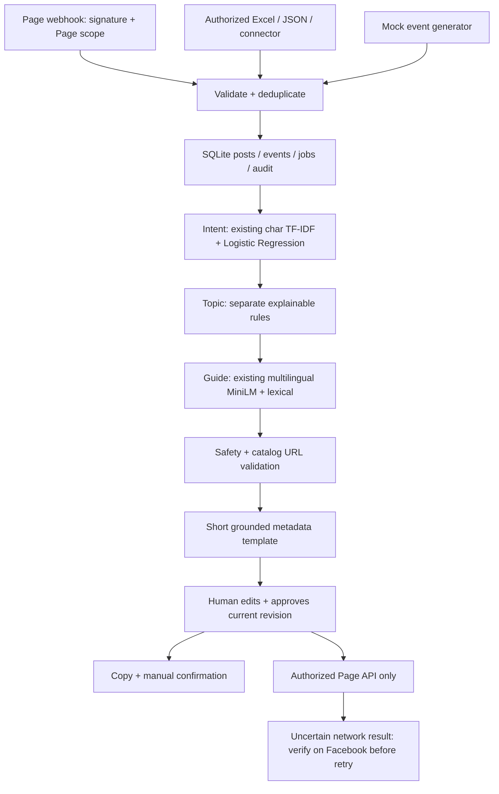

# แอพคุณหมอใจดี — Node/SQLite workflow

## เปิดและทดลอง

ต้องใช้ Node **22.13+** (เครื่องที่ทดสอบใช้ Node 24.18.1) ไม่ต้องใช้ API key สำหรับ Core MVP

```powershell
npm.cmd ci
npm.cmd run guides:download
Copy-Item .env.example .env  # เฉพาะตอนยังไม่มี .env
npm.cmd start
```

เปิด `http://127.0.0.1:4173` จะเข้าหน้าภาพรวม ระบบเดิมอ่านโพสต์ นำเข้า Excel เลือกหมวด ค้นหา บันทึก และจับคู่คู่มือยังอยู่ในเมนู

1. ภาพรวม → สถานการณ์ “แผลบวมหลังทำหมัน” → **รับ 1 โพสต์** หรือ **รับอัตโนมัติ 3 โพสต์**
2. Inbox → เลือกโพสต์ รอ ML และอ่านคู่มือ/ประเด็นที่ต้องตรวจ
3. แก้ร่าง → บันทึก → อ่านและทำเครื่องหมายยืนยัน → อนุมัติ
4. **คัดลอกคำตอบที่อนุมัติ** แล้วเลือกนำไปตอบเอง การคัดลอกยังไม่ใช่การเผยแพร่
5. เมื่อได้ตอบผ่านช่องทางที่มีสิทธิ์แล้วจึง **ยืนยันว่าตอบด้วยตัวเองแล้ว** ประวัติระบุชัดว่าเป็นการยืนยันโดยผู้ดูแล ไม่ใช่ผลตรวจจาก Facebook API
6. ถ้าต้องถามต่อ เปิด “ถามต่อหรือปรึกษาสัตวแพทย์” → เตรียมคำถาม แก้ข้อความ คัดลอก และเปิด MeongSilJang แยกกัน กรณีปัสสาวะไม่ออกจะไม่แสดงทางเลือกให้รอ chatbot

นำเข้าข้อมูลจริง: **รับโพสต์** → กรอกข้อความ/URL หรือเลือก Excel/JSON → เลือกชีต/เทียบคอลัมน์และดูตัวอย่าง → ยืนยันสิทธิ์ใช้ข้อมูล → รับเข้า SQLite สูงสุด 200 โพสต์/รอบ UI รายงานรับใหม่/ซ้ำ/ผิดพลาดเป็นรายรอบ ส่งเฉพาะข้อมูลคอลัมน์ที่เลือก ไม่เก็บไฟล์ Excel ในฐานข้อมูล

URL ใช้เป็นที่มาและตัวระบุซ้ำ **ไม่ได้ดึงเนื้อหา Group จากลิงก์** หากมีเพียง URL จะถูกส่งให้คนตรวจว่าไม่มีข้อความ ทางนำเข้าหลักควรแนบข้อความที่มีสิทธิ์ใช้มาด้วย หน้า “นำเข้า Excel” เดิมยังคงรับคอมเมนต์หลายแถว/ถอดความและ preview แบบเดิมในเบราว์เซอร์ โดยข้อมูลใน reader ไม่ถูกส่งเข้า Inbox เอง

## โครงสร้าง



ไฟล์หลัก: `server/workflow*.mjs`, `server/source-adapters.mjs`, `lib/workflow-policy.mjs`, `lib/workflow-ui.mjs`, `workflow.css` และ `server.mjs` ต่อ API เดิม `server/intent.mjs`/`server/guides.mjs` ฐานข้อมูลเริ่มสร้างเมื่อเปิด CLI เก็บที่ `data/runtime/workflow.sqlite` ไม่เสิร์ฟผ่าน HTTP และไม่เข้า Git

Intent มีคะแนนจัดลำดับและสถานะไม่มั่นใจ ไม่ใช่ calibrated clinical confidence Topic 5 กลุ่มเป็น multi-label rules มี `confidence:null` ไม่ใช่โมเดลโรคใหม่ คู่มือใช้ชื่อ/คำอธิบายเท่านั้น ไม่อ้างว่าอ่านบทความเต็ม ร่างตอบเป็น `grounded_metadata_template` ไม่ใช่ LLM; มี ML จริงสองส่วนที่ reuse จากเดิม

## สถานะ / ความทนทาน

`queued → processing → awaiting_review / needs_review → approved → publishing → published`

- `error`: วิเคราะห์ล้มเหลวครบ 3 ครั้ง เริ่มใหม่เองได้จาก Inbox
- `publish_unknown`: อาจส่งสำเร็จแต่ server ไม่ได้ผลกลับ/หยุดระหว่างส่ง ต้องตรวจ Facebook และระบุว่าพบหรือไม่พบคอมเมนต์ก่อนส่งอีกครั้ง ไม่มี auto-retry publish
- SQLite ใช้ WAL, transaction, unique source/event keys, revision check และ publication outbox กันส่งซ้ำ งานประมวลผลมี lease 120 วินาที/heartbeat 20 วินาทีและ retry backoff 1/2/4 วินาที หลัง crash งานคืนคิวเมื่อ lease หมด งานถูกขัดจังหวะครบ 3 ครั้งต้องให้คนตรวจ
- Source key คือ source type + post ID ถ้ามี ไม่เช่นนั้นใช้ URL หรือ hash ข้อความ event เดิมที่มีเนื้อหาต่างกันตอบ 409 ไม่เขียนทับเงียบ ๆ เปลี่ยน source type/รหัสใหม่อาจเป็นคนละโพสต์ จึงต้องให้ connector ส่งรหัสที่เสถียร
- แก้ร่างทำให้ approval เดิมหมดอายุ ต้องอนุมัติ revision ปัจจุบันเท่านั้น ประวัติเก็บร่างก่อน/หลังและ actor; ชื่อ actor จาก client เป็นเพียงป้ายบันทึก ยังไม่ใช่ identity ที่ยืนยันแยกคน
- Mock stream เป็นตัวกระตุ้นใน process ไม่ใช่ scheduler ถ้า server หยุด ตัว stream หยุด แต่ events ที่ลง SQLite แล้วไม่หาย

## Environment

| ตัวแปร | การใช้ |
|---|---|
| `PORT`, `HOST` | ค่าเริ่ม 4173 / 127.0.0.1 |
| `WORKFLOW_DB_PATH` | SQLite path; ต้องเป็น persistent disk สำหรับ hosting |
| `OPERATOR_TOKEN` | ป้องกัน API ผู้ดูแล เก็บในหน่วยความจำหน้าเว็บ ไม่มีใน URL/localStorage; ถ้าเปิด origin ภายนอกต้องยาวอย่างน้อย 32 ตัวอักษร |
| `INGEST_TOKEN` | Bearer token สำหรับ connector คนละค่า/สิทธิ์กับ operator |
| `PUBLIC_ORIGIN` | HTTPS origin ที่อนุญาตเมื่อวางหลัง reverse proxy; ไม่ใช่เพียงตั้งค่าแล้ว deploy สำเร็จ |
| `META_*` | ดูเอกสาร Facebook ต้องมี Page token/App ID/secret/verify token/version จริง ไม่มีใส่ไว้ใน repo |
| `META_PAGE_PUBLISH_ENABLED` | `false` เริ่มต้น เปิดไม่ได้ข้าม human approval หรือ permission |
| `MEONGSILJANG_URL` | ลิงก์เปิดบริการเดิม ไม่ส่งเคสใน URL |
| `TELEVET_URL` | เว้นว่างจนมีลิงก์ที่ตรวจสอบได้ |

`.env`/ฐานข้อมูลถูก ignore หากมี `.env` เดิม ให้เพิ่มค่าที่จำเป็นแทนการคัดลอกทับ Keys อยู่ server เท่านั้น ข้อความในโพสต์/คอมเมนต์เป็นข้อมูล ไม่ทำตามคำสั่งฝังในข้อความ ทุกส่วนแสดงด้วยการ escape ไม่ฝัง HTML

## API สำหรับทดสอบ / connector

- `GET /api/workflow/status`, `GET /api/workflow/posts?status=attention`, `GET /api/workflow/posts/{id}`
- `POST /api/workflow/mock` `{ "scenario":"neuter", "eventId":"repeatable-test" }` ส่งซ้ำ key เดิมต้องคืน `duplicate:true`
- `POST /api/workflow/import` `{ "authorized":true, "posts":[{"sourceType":"group","externalId":"stable-id","text":"...","url":"https://..."}] }`
- `POST /api/sources/events` รูปแบบ event เดียวกัน + `authorized:true` ต้องมี `Authorization: Bearer <INGEST_TOKEN>` ไม่ยอมให้ client ปลอม source Page ผ่านทางนี้
- `POST /api/workflow/posts/{id}/draft` `{text,revision}`; `/approve` `{revision,acknowledged:true}`; `/copy` `{revision}`; `/manual` `{revision,confirmed:true}`
- Page webhook / verification / import / publish ดู [Facebook integration](FACEBOOK-INTEGRATION.md)

## การตรวจรับ

```powershell
npm.cmd run check
npm.cmd test
```

`tests/workflow.test.mjs` ตรวจครบ 12 acceptance criteria: โมเดลจริง การจับคู่ URL catalog จริง ไม่มีคู่มือ/ข้อมูลไม่พอ ยา/ราคา/ความเชื่อ ป้องกันตอบก่อนอนุมัติ ซ้ำ/รีสตาร์ต/retry/edit history และ Page transport จำลอง `tests/workflow-ui.test.mjs` ใช้ DOM + HTTP + SQLite + ML จริง ตั้งแต่ Dashboard/รับ Mock/Inbox/แก้/อนุมัติ/clipboard/ถามต่อ รวม JSON/Excel/ข้อมูล HTML และ static-site fallback โดย clipboard/dialog เป็น test doubles ไม่ใช่หลักฐานส่ง Facebook จริง

ผลตรวจวันที่ 20 พฤศจิกายน 2569: **90 tests ผ่าน ไม่มี skip** และ `npm.cmd run check` ผ่าน ทดสอบ HTTP กับ CLI ที่เปิดจริงบนพอร์ต 4186 แล้วรับ Mock เคสแผลบวมหลังทำหมันได้: Topic เป็นหลังทำหมันและบาดแผล คู่มืออันดับแรก `cat-post-neuter-recovery-care` คะแนนประมาณ 0.491 ร่างมี URL จริง ส่วน Intent อันดับแรก advice ประมาณ 0.516 ต่ำกว่าเกณฑ์ โมเดลจึงคืน `unclear/needs_review` อย่างตรงไปตรงมา ไม่บังคับผลให้ดูมั่นใจ เวลา processing ใน smoke test ประมาณ 1.4 วินาที ไม่ใช่ benchmark

Browser access host ไม่พร้อม และ Computer Use หยุดเพราะตรวจ URL ใน Chrome ไม่ได้ จึงยังไม่ยืนยันภาพหน้าจอและการแตะบนมือถือจริง CSS มี responsive breakpoints และ DOM flow ผ่าน แต่ต้องตรวจบนอุปกรณ์จริงอีกครั้ง

## Hosting และสิ่งที่ยังไม่ยืนยัน

เว็บไซต์สาธารณะเดิมเป็น **static** ใช้ reader/ML ใน browser และแสดงว่า Inbox ยังไม่มี server ไม่ย้ายข้อมูลผู้ดูแลไป localStorage เพื่ออ้างว่า persistence สำเร็จ Core Node ต้องวางบน host ที่รองรับ Node + native ONNX + persistent SQLite disk ใช้ HTTPS reverse proxy และจำกัดการเข้าถึงทั้งเว็บเฉพาะทีมก่อนเปิดใช้งานจริง **อย่า expose Node นี้ต่ออินเทอร์เน็ตโดยมีเพียง token หน้า Inbox:** หน้าข้อมูลวิจัย/Excel/annotation เดิมเป็นเครื่องมือภายใน ต้องมี authentication ชั้นหน้าเว็บด้วย

ยังไม่มี Page credentials/App Review, Group connector ที่ยืนยันสิทธิ์, Chatbot API หรือ Televet API ไม่มีการส่งคอมเมนต์จริงในรอบพัฒนานี้ ตัวกรองข้อความ/คำสั่งยาด้วย regex ไม่ครอบคลุมทุกภาษาและไม่ใช่การรับรองทางคลินิก ต้องให้สัตวแพทย์ตรวจและจัดชุดทดสอบก่อนเปิด production ดู [VPC_COVERAGE.md](../VPC_COVERAGE.md)
